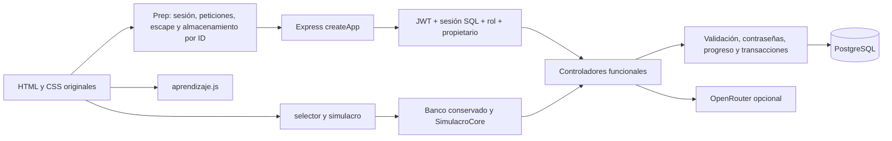

# Arquitectura real

Se mantiene HTML/CSS/JavaScript sin framework. Express sirve archivos y API del mismo origen.
Se eligieron módulos funcionales: esta aplicación no necesita clases artificiales para producir métricas OO.
No hay clases declaradas propias. Las entidades SQL/conceptuales no equivalen a clases JavaScript.

`createApp({pool, aiClient})` permite integrar un pool real o un driver de pruebas sin tocar
los controladores. Producción usa `pg`; las pruebas suministran un adaptador de PGlite con
mutex de conexión/transacción. PGlite ejecuta PostgreSQL en WASM, no un mock de respuestas SQL.
No cubre TLS, red, pool externo, RLS ni configuración propia de Supabase.

## Contratos relevantes

- Cookie `token_acceso`: HttpOnly, SameSite=Lax, Secure en producción, duración 24 horas.
- JWT HS256 con issuer/audience y jti. La tabla `sesiones` permite revocación inmediata.
- La identidad/rol/correo actuales se vuelven a consultar en SQL. Un cambio de correo no invalida relaciones por ID.
- El navegador conserva metadatos de usuario, nunca el JWT nuevo en localStorage. `X-Prep-User` evita acciones de pestañas pertenecientes a otra cuenta; no sustituye la autenticación.
- Progreso detallado: claves `prepicfes:u:<id>:<prefijo>_correctas` y `_completados`, más JSONB SQL. La fusión por claves no suma dos veces una respuesta y no disminuye porcentajes históricos.
- Simulacros: banco único consumido por navegador/API; resultados independientes del progreso académico.
- Intento de simulacro: se guarda por usuario al responder, al salir y durante el reloj. Recargar recupera orden, respuestas y tiempo acumulado; iniciar desde el selector genera un intento nuevo. El tiempo fuera de la página queda pausado. Un resultado terminado se recupera y reenvía con el mismo UUID.
- Fotos nuevas: bytea, MIME reconocido por firma y nombre UUID; máximo 2 MiB. No se acepta SVG ni HTML. La comprobación de firma no es análisis antivirus ni decodificación exhaustiva de imagen.
- Fotos antiguas: se conserva el fallback a `backend/uploads`; requieren traslado manual si el despliegue previo almacenaba archivos en disco efímero. Los enlaces de avatar son recursos accesibles por URL; no deben usarse para documentos privados.
- La compatibilidad de fotos antiguas solo sirve PNG/JPEG/WebP con sandbox; se rechazan archivos HTML/SVG u otros formatos activos. Las rutas interpoladas en atributos se escapan.
- Errores API: mensajes genéricos y códigos HTTP; sin SQL, claves o prompts en logs.
- Origen: mismo origen por defecto, lista explícita para CORS. Las peticiones con `Sec-Fetch-Site: cross-site` se rechazan. No se ha habilitado confianza arbitraria en proxies.
- CSP mantiene `unsafe-inline` para conservar handlers y estilos actuales. Está documentado como limitación; la defensa contra XSS también depende del escape de datos y de las pruebas.
- El límite de solicitudes vive en memoria por proceso. Un despliegue con varias instancias requiere un almacén compartido y límites en su gateway.

Los HTML educativos son archivos estáticos; la información personal y las mutaciones se protegen
en la API. Los indicadores de sesión del frontend facilitan la navegación, y no se consideran autorización.

## Decisiones comprobables

Se extrajeron los objetos originales `BANCOS` y `CONFIG_AREAS` a `banco-simulacro.js` sin cambiar
sus valores: la prueba estática compara ambos objetos contra `c071262`. La lógica de cinco módulos
se comparte conservando HTML y handlers de preguntas. Los tres CSS no se editaron.

Las claves globales históricas de ejercicios se conservan y no se asignan automáticamente a una
cuenta: su propietario es ambiguo. Tras comprobarlo manualmente, iniciar sesión y ejecutar
`Prep.importLegacyProgress()` en el navegador; abrir los módulos para sincronizar. Se copian
solo espacios nuevos sin datos previos y los originales permanecen disponibles.

## Contraseñas

scrypt con N=131072, r=8, p=1, sal de 16 bytes y resultado de 64 bytes; parámetros incluidos
en el hash y comparación de tiempo constante. Se fijó maxmem=256 MiB en Node para permitir ese
perfil. La selección sigue la [guía OWASP de almacenamiento de contraseñas](https://cheatsheetseries.owasp.org/cheatsheets/Password_Storage_Cheat_Sheet.html).
Las pruebas no miden resistencia criptográfica: verifican almacenamiento, sal, comparación y migración.
El secreto JWT debe persistirse en el entorno; en desarrollo sin secreto se genera uno efímero y las
sesiones dejan de ser válidas al reiniciar. En producción se rechaza un secreto ausente o menor de 32 caracteres.
