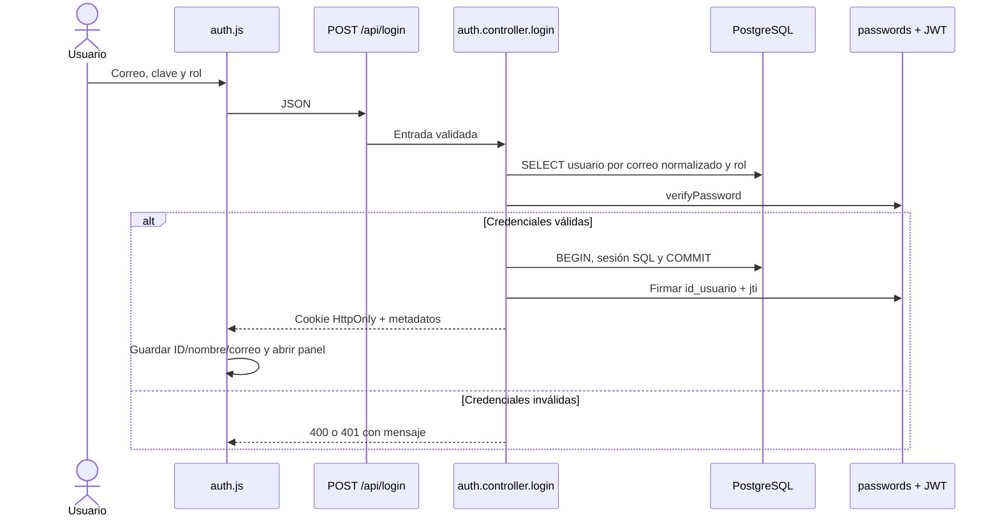
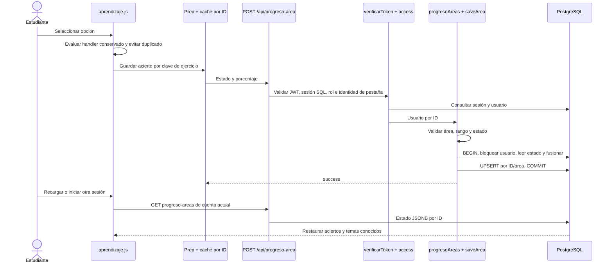
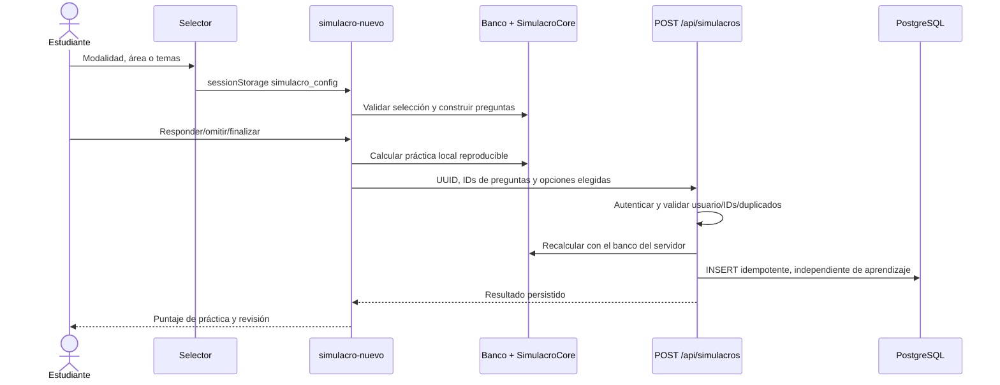
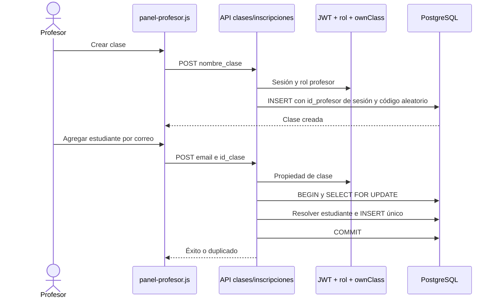
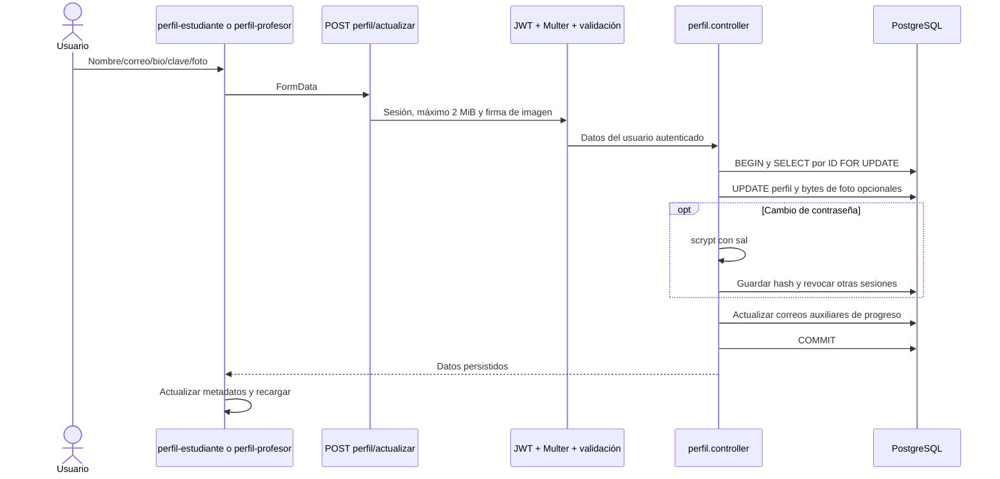

# Secuencias de los hilos ejecutados

Estos participantes corresponden a módulos/funciones reales. Los nombres CU02/CU03/CU05/CU11/CU08
siguen la misión recibida; no se inventaron actores o clases del código.

## CU02: sesión

## CU03: aprendizaje

Si falla la red, el estado local se conserva y se vuelve a intentar al abrir el módulo.
Los porcentajes antiguos sin detalle se muestran como mínimo histórico; no se inventa qué
ejercicio había contestado la persona. Ciencias no puede completar tres temas sin sus ejercicios.

## CU05: simulacro

El resultado queda también en `ultimo_simulacro` del espacio por usuario. Si falla la API se
marca pendiente; no se afirma que esté persistido en servidor. Reenviar el mismo UUID es seguro.

## CU11: clases

La eliminación sigue el mismo control de propietario y ejecuta borrado de inscripciones y
clase en una transacción. Un profesor ajeno obtiene404 y no altera filas.

## CU08: perfil

## Valores y estados de los hilos

| Hilo | Precondición/entrada | Estado esperado | Negativo comprobado |
|---|---|---|---|
| CU02 | Usuario QA, clave fixture y rol coincidente | Sesión SQL + cookie; panel del rol | clave/rol incorrectos, token expirado |
| CU03 | Estudiante A, 8 ejercicios del tema0 | 20 % Matemáticas, 4 % global; tema recuperable | B no recibe avance; repetir no incrementa |
| CU05 | Área Inglés y respuestas/omisiones | suma de estados = preguntas; puntaje cliente = servidor | pregunta repetida/desconocida e ID de resultado ajeno |
| CU11 | Profesor P y estudiante registrado | clase de P, inscripción única y anuncio visible | P2 no puede ver/editar/eliminar clase de P |
| CU08 | Cuenta autenticada y correo nuevo único | mismo ID, mismas clases y progreso | correo duplicado revierte toda modificación |

La evidencia concreta de cada ejecución está enlazada desde `trazabilidad-pruebas.md` y los reportes.
