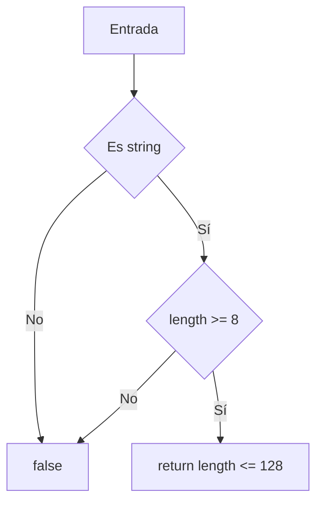
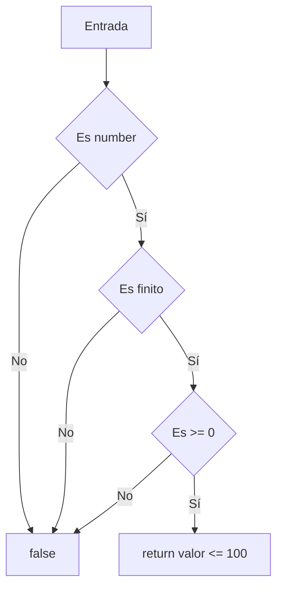
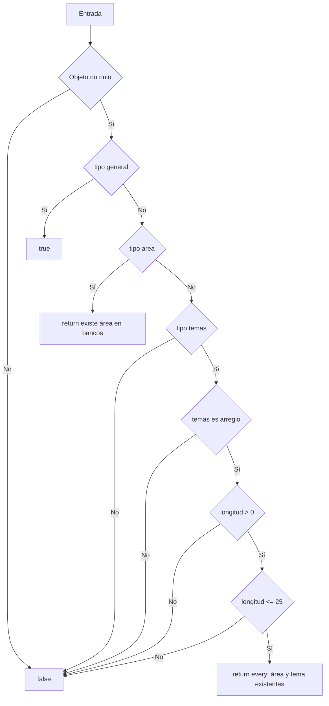
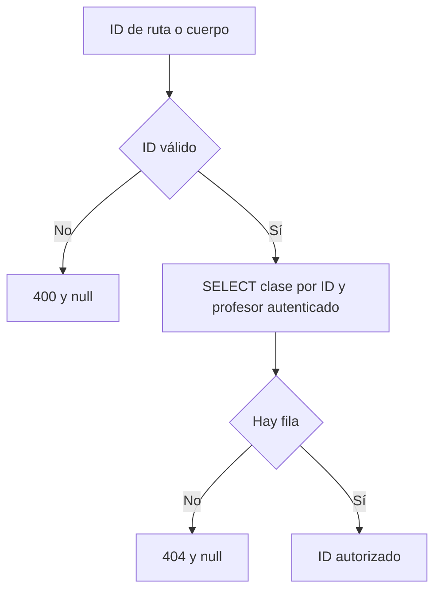
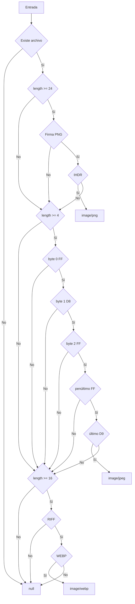

# Pruebas y trazabilidad

Los resultados se generan al ejecutar, no se rellenan como aprobados por anticipado.
`node scripts/qa/test-report.cjs` escribe JSON, JUnit XML, LCOV y texto con cobertura.
`npm run test:e2e` ejecuta CA01–CA05 y variantes en los navegadores instalados.
El listado final de casos, duraciones, rutas y líneas está en los reportes, junto con fecha y entorno.

## Equivalencias y límites reales

| Módulo | Entrada | Clases válidas / inválidas | Valores y resultado esperado | Implementación/pruebas |
|---|---|---|---|---|
| M1 | Correo | Texto con @, dominio y punto / vacío, sin dominio, no texto | `a@example.test` válido; `a@b`, null y cadena vacía rechazados | validation.email, M1-CE, IT01 |
| M1 | Contraseña nueva | Cadena 8–128 / otros tipos o longitudes | 0,1,7: rechazo; 8,9,127,128: válido; 129: rechazo | validation.password, M1-VL |
| M1 | Credenciales/rol | Cuenta/clave/rol coincidentes / desconocidos o diferentes | Válido 200+cookie; incorrecto 401; datos mal formados 400 | IT01, CA01 |
| M1 | Sesión | JWT vigente y sesión SQL / ausente, alterada, expirada, revocada | 401 sin sesión; otra cuenta en cabecera 403 | IT01/IT08, SEC |
| M2 | Porcentaje | Número finito 0–100 / fuera de rango, cadena, null | −1,101,NaN,Infinity,`"50"`,null: rechazo; 0,0.1,99.9,100: válido | M2-VL, IT02 |
| M2 | Estado | Ejercicios 0–4 × 0–7, booleano true y temas completos / claves o temas inválidos | `0-0` válido; `5-0`, `0-8`, false, completado sin ocho aciertos: rechazo | M2-CB |
| M2 | Repetición y cuentas | Mismo ejercicio varias veces / usuario distinto | No aumenta dos veces; A/B separados, incluidas pestañas | IT02, storage.test, CA02 |
| M3 | Configuración | General, área existente, temas existentes no vacíos / modalidades o entradas inválidas | null, área inexistente, temas vacíos o desconocidos: rechazo/retorno al selector | M3-CB, CA03-extra |
| M3 | Respuesta/resultado | Índice válido u omisión / índice fuera de opciones, pregunta repetida/desconocida | Cero preguntas: error; todas omitidas: 0 y todas omitidas; todas correctas: 500; mitad: 250 con pesos iguales | M3-CE/VL, CU05 |
| M3 | Persistencia | UUID nuevo / mismo UUID / UUID de otra cuenta | 201 / 200 sin duplicar / 409; servidor ignora booleanos de acierto aportados | CU05 integración |
| M4 | Nombre de clase | Texto 1–120 tras trim / vacío/no texto/exceso | 0 y121: rechazo; 1,119,120: válido | M4/M5-VL, IT03 |
| M4 | ID/propiedad | Entero positivo seguro propio / inválido o ajeno | 0,−1,`abc`,inyección,1.2,fuera de entero seguro: rechazo; ID ajeno:404 | M4-CE, IT03/IT04 |
| M4 | Inscripción | Estudiante existente no inscrito / inexistente, profesor o duplicado | Inscribir 200; duplicado409; ajeno404; retirar no afecta otros grupos | IT04, IT09, CA04 |
| M4 | Anuncio | Cadena 0–5000 / exceso/no texto | 0,1,4999,5000: válido;5001: rechazo | M4-VL, IT05 |
| M5 | Nombre/correo/biografía | Perfil propio y correo único / ajeno, duplicado o campos inválidos | Nombre1–120; bio0,1,1999,2000 válidos;2001 no; duplicado409 | M5-VL, IT06, CA05 |
| M5 | Contraseña | Igual restricción 8–128 / fuera de rango | Hash guardado y otras sesiones revocadas; sesión actual conservada | IT08 |
| M5 | Foto | Firma PNG/JPEG/WebP ≤2 MiB / otro contenido o tamaño mayor | SVG disfrazado:400;2MiB+1:413; PNG servido con mismos bytes y MIME | M5-CE, IT07 |

Se distinguen límites de aplicación y restricciones SQL. El registro nuevo exige 8–128 caracteres;
el login permite contraseñas históricas no vacías de hasta128 durante la conversión explícita.
No se inventó un límite de tiempo de examen: el temporizador actual mide tiempo transcurrido.
El POST de resultados acepta segundos enteros entre0 y86400 como validación de persistencia.

## Caja blanca y camino básico

La complejidad reproducible se exporta por función en `evidencias/metricas/actual.json`.
Convención: V=1+if+bucles+catch+ternarios+casos switch no-default+operadores lógicos.
Las funciones anidadas y callbacks se cuentan por separado. No se trata esta cifra como WMC de clases.

Funciones elegidas: M1 `password`, M2 `percentage`, M3 `validConfig`, M4 `ownClass`, M5 `imageType`.
Los diagramas muestran decisiones y salidas; los `&&`/`||` se expanden en cortocircuitos para
el conteo. La lista exacta de complejidades queda en el inventario generado de caminos.

### M1: password

V=3. Caminos independientes: tipo inválido, cadena menor que8, cadena de al menos8 con
retorno de comparación máxima. El último se prueba tanto verdadero como falso con128/129.

### M2: percentage

V=4. Caminos: no número; NaN/Infinity; negativo; número finito no negativo con comparación
superior. El último tiene ejemplos0,100,101. La cobertura de decisiones se mide en la ejecución.

### M3: validConfig

V=9 en la función externa, incluyendo la disyunción del primer guard. Caminos: nulo, tipo
no objeto, general, área, otra modalidad, temas no arreglo, vacío, más de25 y arreglo de
longitud válida. El callback `every` tiene sus propias ramas: elemento nulo, área inexistente,
tema inexistente y válido. Los casos M3-CB ejercitan esos datos; no se infiere cobertura100 %
del módulo completo a partir de un solo grafo.

### M4: ownClass

La selección de ID también usa `||`; el reporte AST incluye esos cortocircuitos. Los tres
caminos de negocio son ID inválido, clase ajena/inexistente y clase propia. IT03/IT04/IT09
los recorren a través de HTTP, incluyendo entradas por ruta y por cuerpo.

### M5: imageType

V=14. Caminos independientes: sin archivo; tamaño insuficiente; PNG correcto; PNG sin IHDR;
PNG con firma distinta; JPEG correcto; cada uno de sus cinco bytes de firma inválido;
WebP correcto; RIFF inválido; WEBP inválido. M5-CE incluye buffers de esos caminos. Esto
comprueba las firmas implementadas; no afirma decodificación completa o detección de malware.

## Integración ejecutada

| Estrategia/caso | Componentes y orden | Dependencias/driver | Resultado verificable |
|---|---|---|---|
| Ascendente INT-ASC | Validación/crypto → SQL → transacción → controlador → HTTP | Node test driver y PostgreSQL WASM; SQL real | rollback por FK, reinicio con disco y endpoints reales |
| Descendente INT-DESC | Router Express → auth/controlador IA → interfaz del cliente externo | Cliente IA stub explícito | éxito artificial del stub,429 y respuesta vacía; no acredita OpenRouter real |
| Hilo CU02 | Formulario → auth → SQL/crypto → cookie → panel | Playwright + API + SQL, sin mocks de red | CA01 y IT01 |
| Hilo CU03 | Ejercicio → estado por ID → API → merge SQL → recarga | Playwright + API + SQL | CA02, IT02 |
| Hilo CU05 | Selector → banco → respuesta → core → API recálculo → revisión | Playwright + API + SQL | CA03, CU05 integración |
| Hilo CU11 | Profesor → creación → inscripción/anuncio → estudiante | Dos sesiones de navegador + API + SQL | CA04, IT03–IT05 |
| Hilo CU08 | Perfil → multipart/JSON → validación → transacción SQL → recarga/logout | Playwright + API + SQL | CA05, IT06–IT08 |

Las referencias IT01–IT08 se concretaron en pruebas del repositorio; no se dispuso del documento
académico previo para cotejar literalmente sus tablas históricas. Se cubren aislamiento,
persistencia, anuncios, eliminación y fotografía sin presentarlas como transcripciones del antecedente.

## Casos detallados

`evidencias/pruebas-unitarias/casos.csv` relaciona ID, módulo, requisito, objetivo, precondición,
entrada/pasos referenciados a código ejecutable, resultado esperado, resultado real, estado y evidencia.
Las aserciones del archivo/línea indicado son la definición exacta de entrada y expectativa.
Los recorridos CA incluyen capturas separadas de estudiante y profesor; los errores JS también se comprueban.
La aceptación formal por usuarios/docente continúa pendiente aunque la automatización pase.
